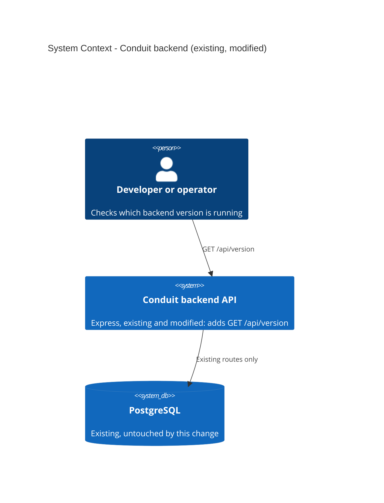
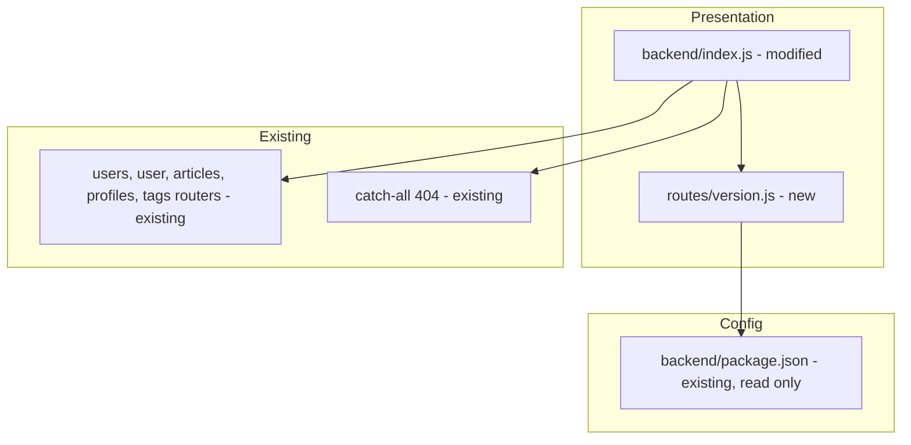

# Architecture — Conduit backend version endpoint (KAN-25)

> **Version**: 1.0.0 · **Generated**: 2026-11-19T13:04:17Z · **Forge**: v1.0
> **Derived from**: spec/plans/knowledge-hub-deep-dive.md, spec/plans/requirements.md, spec/plans/stories.md (design stages all skipped, see executions.md)
> **Existing-system baseline**: none (Knowledge Hub not consulted; the deep dive was derived locally from the workspace code)

## 1. System Context
Conduit is a RealWorld blogging platform. The Express backend (backend/) serves its REST API under /api to the Vite frontend. This cycle adds one public read-only endpoint so a developer, operator or tool can read the backend name and version. Elements: backend (existing, modified), caller (new consumer), PostgreSQL (existing, untouched).

## 2. Component Inventory
| Component | Responsibility | Status | Source |
|---|---|---|---|
| backend/index.js | App bootstrap, mounts routers, catch-all 404 | existing (modified: one require, one app.use) | knowledge-hub-deep-dive.md |
| backend/routes/version.js | Router returning {name, version} for GET / | new | requirements.md REQ-F-01..04 |
| backend/package.json | Source of the version value | existing (read only) | knowledge-hub-deep-dive.md |
| Version unit test (tests/unit/backend/routes/version.test.js) | Verifies the contract | new | requirements.md REQ-F-05 |

## 3. Layering and Boundaries
- The version router lives under backend/routes/ and is mounted under /api in backend/index.js before the catch-all 404.
- The version router may require only express and backend/package.json. It must not import models, controllers, middleware or helpers.

## 4. Data Architecture
No store, schema or model is introduced or changed (no erDiagram needed). Delta: none.

## 5. API and Integration Contracts
- GET /api/version, public, no parameters. 200 with application/json body {"name":"conduit","version":"<backend/package.json version>"}. Only those two string fields.
- No new error model: if backend/package.json cannot be read, the process fails at startup (module load), so no request is ever served with a wrong version.

## 6. Cross-Cutting Decisions
- AuthN/AuthZ: deliberately none for this route (Epic decision, REQ-F-03). All other routes unchanged.
- Error handling: startup failure, no runtime handling. Logging: existing behaviour, nothing new. Configuration: none (version read from package.json, not an environment variable).
- Resiliency: baseline not enabled by the user.

## 7. Non-Functional Targets
| Concern | Target | Source | How it is verified |
|---|---|---|---|
| Per-request cost | No per-request I/O; value held in memory | REQ-NF-04 | code review of the router |
| Dependencies | No new dependency | REQ-NF-01 | package.json diff |
| Exposure | Only name and version in the response | REQ-NF-03 | unit test exact body |

## 8. Infrastructure and Deployment
No change. The backend deploys as today (npm start runs node index.js).

## 9. Delta from the Existing System
| Area | Before | After | Reason |
|---|---|---|---|
| Public API | No version route; unknown GET paths return 404 | GET /api/version returns name and version | KAN-25 |
| backend/index.js | 5 routers mounted | 6 routers mounted | KAN-25 |

## 10. Verifiable Constraints

### ARCH-01 — Dedicated router mounted before the catch-all
- **Constraint**: The version endpoint is its own express.Router module under backend/routes/ and is mounted with app.use("/api/version", ...) before the catch-all app.get("/*any") in backend/index.js.
- **Verifiable as**: In the diff, the route handler is defined in a file under backend/routes/ (not inline in index.js) and the app.use line precedes the catch-all. Score 0 if the handler is inline in index.js or mounted after the catch-all.
- **Weight**: 0.25
- **Source**: spec/plans/requirements.md (REQ-F-03, REQ-NF-02)

### ARCH-02 — Version comes from package.json, once
- **Constraint**: The version value is read from backend/package.json at module load and not hardcoded or read from the environment.
- **Verifiable as**: The version string in the changed code originates from a require or import of backend/package.json evaluated at module load, not inside the request handler. Score 0 for a hardcoded version literal, an env-var read, or a file read inside the handler.
- **Weight**: 0.25
- **Source**: spec/plans/requirements.md (REQ-F-02, REQ-F-04, REQ-NF-04)

### ARCH-03 — Public and stateless
- **Constraint**: The version route has no authentication middleware and no database or model access.
- **Verifiable as**: The changed version router does not reference verifyToken, any auth middleware, models, sequelize, or controllers. Score 0 if any appears.
- **Weight**: 0.20
- **Source**: spec/plans/requirements.md (REQ-F-03)

### ARCH-04 — Exact response contract
- **Constraint**: The response body contains exactly the fields name (the string "conduit") and version.
- **Verifiable as**: The handler responds with res.json of an object with exactly those two keys and no others (no build metadata, no commit hash). Score 0 if any extra field is added or name differs.
- **Weight**: 0.15
- **Source**: spec/plans/requirements.md (REQ-F-01, REQ-NF-03)

### ARCH-05 — No new dependency
- **Constraint**: No dependency is added or changed in any package.json.
- **Verifiable as**: The diff contains no change to dependencies or devDependencies in any package.json or lockfile. Score 0 on any such change.
- **Weight**: 0.15
- **Source**: spec/plans/requirements.md (REQ-NF-01)

## 11. Explicitly Out of Scope
Frontend display, commit hash or build metadata, authentication or rate limiting, runtime handling of an unreadable package.json, any change to the Next.js app under src/, new storage or infrastructure.
