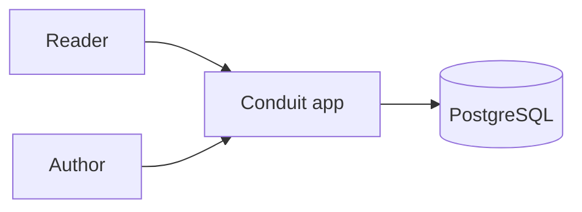

# Business Overview

> Existing-system context derived locally; Knowledge Hub was not consulted. (The studio-knowledge MCP tools were not available in this session; user chose local generation. Facts verified against the code at commit 88d4e6a.)

## Business Context Diagram

## Business Description
- **Business Description**: Conduit is a RealWorld example blogging platform (Medium clone): users register, publish articles with tags, comment, favourite articles and follow authors (README.md, package.json description).
- **Business Transactions**: register and log in; read and update current user; list, feed, create, read, update and delete articles; add and delete comments; favourite and unfavourite; follow and unfollow profiles; list tags.
- **Business Dictionary**: article (slug-addressed post), tag, favourite, feed (articles from followed authors), profile.

## Component Level Business Descriptions
### backend/ (Express API)
- **Purpose**: legacy REST API serving the Vite frontend and production static files.
- **Responsibilities**: the transactions above under /api/*.
### src/ (Next.js app)
- **Purpose**: migrated Next.js 15 app with its own Route Handlers under src/app/api and services in src/lib/services.
### frontend/ (Vite React)
- **Purpose**: legacy React client.
