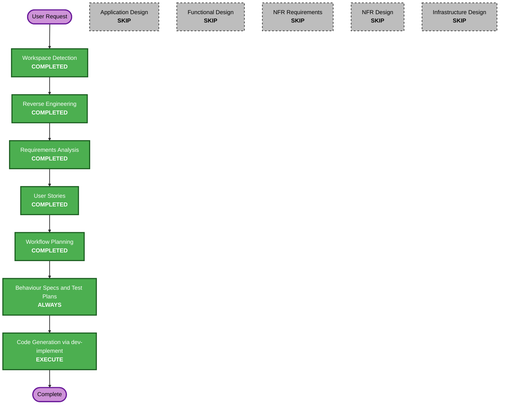

# Execution Plan

## Detailed Analysis Summary

### Transformation Scope
- **Transformation Type**: Single component change (backend/ only)
- **Primary Changes**: new backend/routes/version.js router, one require and one app.use line in backend/index.js (mounted before the catch-all 404), one new unit test file under backend/.
- **Related Components**: none. Next.js app (src/), frontend/ and tests/ are untouched.

### Change Impact Assessment
- **User-facing changes**: No
- **Structural changes**: No
- **Data model changes**: No
- **API changes**: Yes, one additive public read-only endpoint GET /api/version
- **NFR impact**: Minimal (public route; security baseline reviewed in requirements.md)

### Component Relationships
- **Primary Component**: backend (Express API)
- **Infrastructure / Shared / Dependent components**: none affected

### Risk Assessment
- **Risk Level**: Low
- **Rollback Complexity**: Easy (revert one commit)
- **Testing Complexity**: Simple

## Workflow Visualization

Text alternative: Workspace Detection, Reverse Engineering, Requirements Analysis, User Stories and Workflow Planning are complete; the five conditional design stages are skipped; Behaviour Specs and Test Plans run at the STOP checkpoint, then Code Generation runs via dev-implement.

## Phases to Execute

### PLANNING PHASE
- [x] Workspace Detection (COMPLETED)
- [x] Reverse Engineering (COMPLETED, local generation)
- [x] Requirements Analysis (COMPLETED)
- [x] User Stories (COMPLETED)
- [x] Workflow Planning (COMPLETED)
- [ ] Application Design - SKIP
  - **Rationale**: one new router module inside the existing backend; no new components or services, no business rules.

### IMPLEMENTATION PHASE
- [ ] Functional Design - SKIP
  - **Rationale**: no data models or business logic; the response is a fixed two-field object.
- [ ] NFR Requirements - SKIP
  - **Rationale**: stack fixed (existing Express/vitest); NFRs captured in REQ-NF-01..04 and the security baseline review.
- [ ] NFR Design - SKIP
  - **Rationale**: NFR Requirements skipped, no patterns to add.
- [ ] Infrastructure Design - SKIP
  - **Rationale**: no infrastructure changes.
- [ ] Behaviour Specs & Test Plans - EXECUTE (ALWAYS, at the STOP CHECKPOINT, ONE approval)
- [ ] Code Generation - EXECUTE (ALWAYS)

### Verification Engineer TRACK (parallel, not scheduled here)
- Test plan authored at the STOP CHECKPOINT; sign-off via `ve-list-work`.

## Success Criteria
- **Primary Goal**: GET /api/version returns {"name":"conduit","version":"<backend package.json version>"} publicly, with a unit test.
- **Key Deliverables**: backend/routes/version.js, mount in backend/index.js, backend version unit test.
- **Quality Gates**: unit tests, security baseline review, J1/J2 gates, no new dependency.
