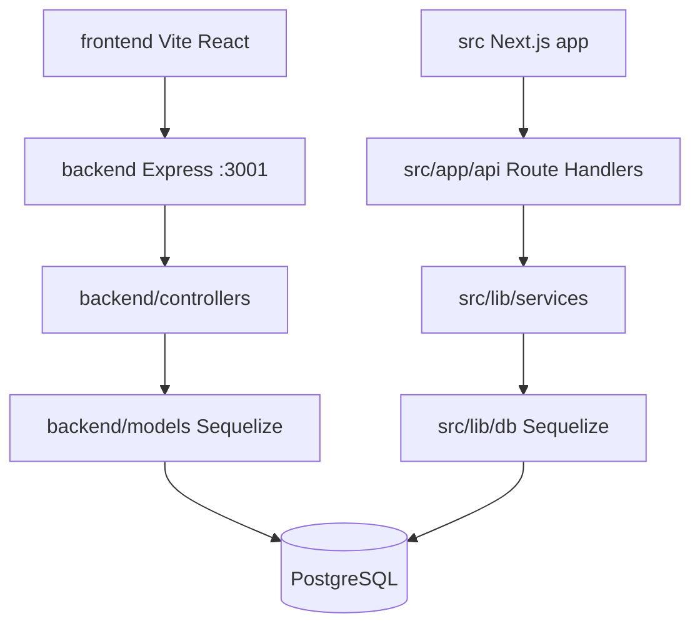
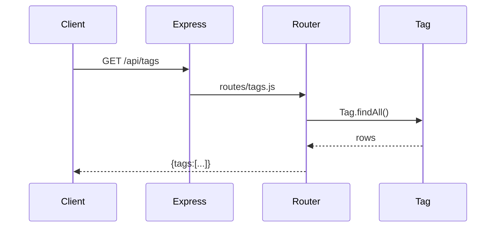

# System Architecture (Deep Dive)

> Existing-system context derived locally; Knowledge Hub was not consulted. (The studio-knowledge MCP tools were not available in this session; user chose local generation. Facts verified against the code at commit 88d4e6a.)

## System Overview
Monorepo (npm workspaces: backend, frontend) mid-migration. Two parallel implementations of the same API exist: the Express backend in backend/ and Next.js Route Handlers in src/app/api backed by src/lib/db (Sequelize).

## Architecture Diagram

## Component Descriptions
### backend (Application)
- **Purpose**: Express 5 REST API. backend/index.js builds the app, mounts routers, runs sequelize.sync({alter:true}) and calls app.listen at module load (it exports nothing).
- **Dependencies**: express, cors, dotenv, jsonwebtoken, bcrypt, sequelize, pg.
### src (Application)
- **Purpose**: Next.js 15 app (App Router pages plus Route Handlers); services in src/lib/services; its own Sequelize models in src/lib/db/models.
### frontend (Application)
- **Purpose**: Vite React client, jsdom component tests.
### tests (Test)
- tests/api (route handler tests against sqlite::memory:), tests/unit, tests/components, tests/behavior (cucumber), tests/e2e (Playwright, disabled for server runs).

## Data Flow

## Integration Points
- **Databases**: PostgreSQL via Sequelize (per-environment config in backend/config/config.js from env vars); sqlite used by tests.
- **External APIs / third-party services**: none found.

## Infrastructure Components
- No Docker, Terraform or CI workflow files found (.github/workflows absent). Deployment: npm start builds the frontend then runs the backend.

## Findings relevant to KAN-25
- **F1**: The Epic says "the backend". The only backend named in the Epic is backend/ (Express). backend/package.json version is 1.0.0. The Next.js app under src/ has no version route, and the root package.json is named conduit-realworld-example-app (also 1.0.0). The change goes in backend/, per the Epic.
- **F2**: backend/index.js has no exports and starts listening on import, so a test cannot import the app. Minimal approach: a small router module (for example backend/routes/version.js) mounted in index.js, tested in isolation.
- **F3**: The root vitest.config.js already includes backend/**/*.test.{js,jsx} (jsdom env); the existing backend test is backend/helper/helpers.test.js. Run with npm test (vitest).
- **F4**: backend/index.js registers a catch-all 404 (app.get("/*any")) after the routers, so /api/version must be mounted before it.
- **F5**: package.json "version" read via require("../package.json") needs no new dependency and fails at startup when missing (matches SC-5).
