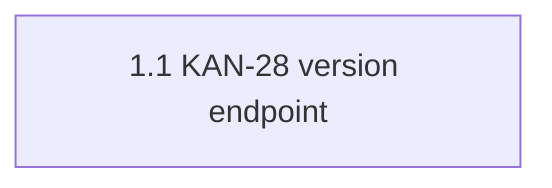

# forge State Tracking

## Project Information
- **Project Type**: Brownfield
- **Start Date**: 2026-11-19T12:56:55Z
- **Current Stage**: Design complete — awaiting dev-implement
- **Forge Framework Version**: 1.0

## Tracker
- Type: JIRA
- Parent Epic: KAN-25
- Epic URL: https://revanta201.atlassian.net/browse/KAN-25
- Project Key / Repo / Org: KAN

## Workspace State
- **Existing Code**: Yes
- **Programming Languages**: JavaScript / TypeScript
- **Build System**: npm
- **Project Structure**: Monorepo (backend/, frontend/, src/)
- **Reverse Engineering Needed**: Yes
- **Workspace Root**: /workspace

## Extension Configuration
- Security Baseline: Enabled (always)
- Playwright Test Automation: Enabled = No (server runs)

## Stage Progress
- [x] Intent Intake and Refinement (KAN-25 labels intent-intake, intake-refined)
- [ ] Workspace Detection (in progress)

## Existing-System Context
- **Workspace type**: brownfield
- **Knowledge MCP**: not connected (tools unavailable in session)
- **Source**: local-generation (Knowledge Hub unavailable, user approved)
- **Knowledge Hub deep dive doc**: spec/plans/knowledge-hub-deep-dive.md (locally generated)
- **Recorded**: 2026-11-19T12:58:39Z

## Branching
- Base Branch: main
- Epic Branch: epic/KAN-25-backend-version-endpoint
- Epic PR: (not raised — raised manually at cycle end via pr-generator)

## Code Root
- **Type**: monorepo
- **Path(s)**: backend/, frontend/, src/
- **Recorded**: 2026-11-19T12:59:32Z
- **Note**: existing tree left in place (not moved into src/). Declared in root package.json workspaces: backend, frontend; plus the root-level Next.js app in src/. New code for KAN-25 goes in backend/ (the package the Epic names), tests in backend/ next to it per the root vitest.config.js include pattern.

## Context Project
- **Existing Knowledge**: No
- **Existing Knowledge Path(s)**: —
- **New References**: No
- **New Reference Path(s)**: —

## Extension Configuration
| Extension | Enabled | Decided At |
|---|---|---|
| Security Baseline | Yes (always) | Workflow start |
| Playwright Test Automation | No (server runs) | Workflow start |
| Resiliency Baseline | No | Requirements Analysis |
| Property-Based Testing | No | Requirements Analysis |

## Stage Progress (PLANNING)
- [x] Workspace Detection
- [x] Reverse Engineering (local generation)
- [x] Requirements Analysis

## User Stories Settings
- team_size: 2 (fixed default, not asked)
- story_creation_mode: all-at-once (fixed default, not asked)

## Story Tracker
| Story | Title | Requires | Tracker ID | Status | PR | Merged | Start | End | Recorded |
|-------|-------|----------|------------|--------|----|--------|-------|-----|----------|
| 1.1 | Confirm the deployed backend version with one request | none | KAN-28 | Ready for Development | — | — | | | 2026-11-19T13:02:43Z |

target_story_count: 1

## Dependency Graph

- Ready stories (no prerequisites): 1.1
- Blocked stories: none
- Note: only one story exists (user-confirmed, REQ coverage 9/9), so the team_size 2 parallelism target cannot apply: there is a single unit of work.
- Jira note: project KAN's workflow has no "Ready for Development" status (statuses: To Do, In Progress, In Review, Done). KAN-28 stays in "To Do", used as the equivalent of Ready for Development.

## Execution Plan Summary
- Stages to execute: Behaviour Specs and Test Plans (at STOP CHECKPOINT), Code Generation via dev-implement
- Stages to skip: Application Design, Functional Design, NFR Requirements, NFR Design, Infrastructure Design (single additive route, no new components, data or infrastructure)
- Requirements coverage verified post-design: 9/9 REQ-IDs (all design stages skipped; no design artifact contradicts the stories) - 2026-11-19T13:03:07Z

## CI/CD Configuration
- Enabled: No
- Source: user opt-out
- Recorded: 2026-11-19T13:07:00Z

## Architecture
- spec/plans/architecture.md v1.0.0; tests/.evals/rubrics/architecture-rubric.json v1.0.0 (5 criteria, regenerated from Section 10); security-rubric.json and tests/.evals/config.json kept as-is (already present)

## Behaviour Specs & Test Plans
- **Work units covered**: 1
- **Behaviour contracts**: spec/behavior/ — 1 file, 8 scenarios (spec/behavior.feature: no cross-unit journeys, recorded explicitly)
- **Manual test plans**: spec/test-plans/ — 1 folder, 13 test cases
- **AC coverage**: 5/5 (scenarios) · 5/5 (test cases)
- **Approved**: 2026-11-19T13:07:18Z

## Status
- Design complete — awaiting dev-implement
